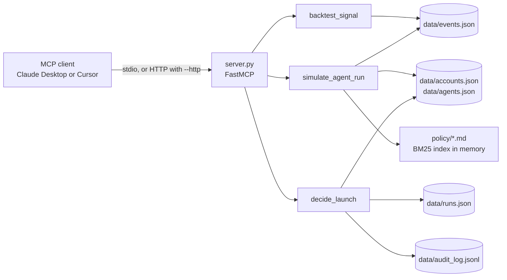

# Preflight

An MCP server that lets an AI client check an automated sales or marketing agent before it is allowed to email prospects or write to a CRM: whether the trigger signal it relies on is worth acting on, what the agent would do and what could collide, and who approved the launch and why.

All data in this repository is synthetic. Preflight is not connected to any agent platform or CRM.

## Overview

Agents that send outbound email and edit CRM records take actions that are difficult to undo. Preflight exposes three checks as MCP tools so that a developer or RevOps analyst can run them from a compatible MCP client in a single conversation:

1. `backtest_signal` tests whether a trigger signal (for example "first GTM hire") has historically preceded booked meetings more often than a no-signal baseline.
2. `simulate_agent_run` performs a dry run of an agent against accounts and reports blockers and warnings, together with the policy passages that apply.
3. `decide_launch` records a human approve or reject decision with a required written reason, and refuses approval while blockers remain.

## Scope and context

Preflight was designed around the kind of platform that lets teams build agents to research accounts, contact prospects and update a CRM, such as Frontrunner (usefr.com). It is an independent project with no affiliation to, and no access to the product of, any such company. The gaps described below are hypotheses based on public product descriptions, not statements about any company's product.

## Problem statement and motivation

Before an outbound agent is switched on, three questions are usually answered informally, if at all:

- Does the signal that triggers the agent actually predict a meeting, or is it noise? Evaluating this correctly requires using only events old enough for the outcome to have been observed. Counting recent events whose outcome window is still open understates the hit rate.
- What will the agent do to the accounts it targets? Typical collisions are emailing a suppressed account, contacting someone who was contacted days earlier, treating one company as two because of spelling differences, and overwriting fields on a customer record.
- Who approved the launch, and on what grounds?

## The gap addressed

Preflight packages these three checks behind a standard protocol so that any MCP client can run them against the same data and rules, and so that the approval step leaves a record.

What it does not do: it is not connected to a real agent platform, so it cannot block a real launch. It runs on synthetic data, so its verdicts say nothing about real-world signals. The "human approves" requirement is a convention (see Security considerations), not an enforced control.

## Key features

- Point-in-time backtesting: only events older than the outcome window are counted, with a Wilson 95 percent interval on the hit rate and a KEEP, DROP or UNSURE verdict. At least 30 events per group are required.
- Dry run with four checks: suppression list, contacted within 7 days (for agents that send email), possible duplicate companies (normalised name plus `difflib` ratio above 0.9), and overwrites on customer records.
- Retrieval over policy documents inside the dry-run tool: BM25 ranking over 120-word chunks, three chunks returned, instead of loading every document into the model context.
- Approval gate with an append-only audit log (`data/audit_log.jsonl`).
- One resource (`policy://guardrails`) and one prompt (`launch_review`).
- Reproducible synthetic data with planted ground truth, so the backtest logic can be checked against known answers.

## MCP architecture and implementation

The server is written with FastMCP from the official `mcp` Python SDK (`mcp.server.fastmcp`). Tools, the resource and the prompt are registered with decorators in `server.py`. The input schema of each tool is derived from its type annotations and the tool description is taken from its docstring, which is what the client's model sees when choosing a tool.



Request flow: the client starts the server as a subprocess (stdio) or connects to it over HTTP, lists tools, resources and prompts, and calls tools with JSON arguments. Each tool is a plain Python function that returns a dictionary, which FastMCP serialises into the response. At start-up the server loads the JSON data into memory and builds the policy index once.

Implemented MCP capabilities:

| Capability | Name | Purpose |
|---|---|---|
| Tool | `backtest_signal` | Evaluate a signal against past events |
| Tool | `simulate_agent_run` | Dry run an agent and surface blockers, warnings and relevant policy |
| Tool | `decide_launch` | Record an approval or rejection with a reason |
| Resource | `policy://guardrails` | Three fixed launch rules as text |
| Prompt | `launch_review(agent_id)` | Instructs the model to backtest, then simulate, read the guardrails, recommend, and not call `decide_launch` |

Input validation and errors: expected failures are returned as a dictionary with an `error` key instead of raising an exception. Checked conditions are an unknown signal, `window_days` outside 1 to 90, fewer than 30 mature events in either group, an unknown agent, unknown account ids, an unknown run id, a decision other than `approve` or `reject`, and an empty reason. If the `data/` directory is missing the server exits at start-up with a message. Other exceptions are not specially handled.

Transport: stdio by default. `python server.py --http` starts streamable HTTP on `http://127.0.0.1:8000/mcp`. Only stdio has been exercised against real clients.

## How it helps in practice

A typical review, run from a compatible client:

1. A person is about to launch or change an agent and asks the client whether to launch it.
2. The client backtests the agent's signal and runs the dry run. The result lists blockers (must fix) and warnings (review), and returns only the policy passages that match the problems found.
3. The person decides. If the person gives a decision and a reason, the client calls `decide_launch`, which refuses approval while blockers remain and otherwise writes a timestamped entry to the audit log.

Compared with a standalone script, exposing this through MCP means any MCP client can use the same checks without client-specific code, and the client's model combines the calls and explains the result in context. Returning matched policy passages instead of whole documents keeps the context small: on the `conference_followup` dry run, the policy documents total 1,576 tokens and the three returned chunks total 500 (tiktoken, cl100k_base), about 68 percent fewer.

Where it fits in a larger process: it sits between designing an agent and enabling it, and its output is a decision record. stdio suits a single user on a local machine. A shared HTTP deployment would suit a team that wants one common audit log, but that mode has not been tested and has no authentication.

Client compatibility, as observed in single sessions (not repeated runs):

| | Claude Desktop (Sonnet 5.5) | Cursor, agent mode (Claude Fable 5) | Cursor, agent mode (Grok 4.5, medium) |
|---|---|---|---|
| Tools listed and callable | Yes | Yes | Yes |
| Tools used for "should we launch conference_followup" | `backtest_signal`, `simulate_agent_run` | `backtest_signal`, `simulate_agent_run` | Not recorded; the captured answer did not address this agent |
| `decide_launch` called without being asked | No | No | Not checked |
| Approval of run R003 with a reason supplied | Refused, 2 blockers | Refused, 2 blockers | Refused, 2 blockers (A177, A238) |
| `champion_reactivation`, which has 4 customer-record overwrites rated as warnings | Flagged them as likely policy violations and advised holding the launch | Reported the run as safe to launch; listed the customer-record rule without connecting it to the warnings | Recommended launching; quoted the rule that customer records must never be overwritten, but did not treat the four overwrites as a problem |
| Numbers in the answer match the data | Yes | Yes | Yes |
| Resource and prompt visible in the client | Not checked | Not checked | Not checked |

All three runs returned numbers that matched the data. The difference was in judgement. The dry run reports `safe_to_launch: true` for `champion_reactivation` because customer-record overwrites are rated as warnings, while the policy text returned alongside it says such overwrites must never happen. One of the three runs identified the conflict, one listed the rule without applying it, and one recommended launching. The tool result and the policy text are consistent with each other only if overwrites are treated as blockers, which the current implementation does not do (see Limitations).

No small local model was run, so it is not known whether a weaker model would confuse `simulate_agent_run` with `decide_launch`. Only Claude Desktop and Cursor have been tested, and none of the runs was repeated.

## Technology stack

| Component | Use |
|---|---|
| Python 3.10 or newer | The code uses `X \| None` annotations. Unit tests and the stdio test were run on Windows with Python 3.14. |
| `mcp` (pinned `<2`), `mcp.server.fastmcp` | Server framework and protocol implementation. The FastMCP import path used here differs in 2.x. |
| `tiktoken` | Token counts (cl100k_base). Falls back to characters divided by 4 if it cannot be loaded; the tool output states which method was used. Loading the encoding typically needs network access the first time. |
| Python standard library | `json`, `math`, `re`, `datetime`, `difflib`, `collections`, `pathlib`, `asyncio`, `unittest`. The Wilson interval, BM25 ranking, chunking and duplicate matching are implemented directly, with no search or statistics library. |
| `unittest` and `test_client.py` | Logic tests and an end-to-end test over real MCP stdio. |

There is no logging library, database or external service.

### pip and uv

The repository has a `requirements.txt` (`mcp<2`, `tiktoken`) and no `pyproject.toml` or lockfile. Either `pip` or `uv` installs from it correctly. The tools are used here for setup only, not for running the server.

Why `uv` is the documented path:

- It creates the environment and installs the dependencies with one tool (`uv venv`, `uv pip install`). Because the commands call the environment's own interpreter, no activation step is needed, which avoids script-execution issues on Windows.
- It is generally faster than `pip` for environment creation and installation. This was not measured for this project, and for two dependencies the difference is small.
- `uv` was already in use for other local MCP servers in the development environment, so no extra tool was needed.

Why the server is not launched through `uv run`: on the Windows development machine, starting the server that way from a client configuration failed at start-up with a file-lock error while packages were being installed, and the client reported the server as disconnected. Installing once into `.venv` and pointing the client at that interpreter avoided the problem. The cause was not investigated further.

Why `pip` is a valid alternative: it ships with Python, so it needs nothing extra. Use `python -m venv .venv`, then `.venv\Scripts\python.exe -m pip install -r requirements.txt` (Windows) or `.venv/bin/python -m pip install -r requirements.txt` (macOS and Linux).

Reproducibility: neither tool creates a lockfile from `requirements.txt`, and `mcp<2` is a range, so resolved versions can differ between installs. Pinning exact versions in a `pyproject.toml` with a lockfile (for example `uv lock`) would address this. The choice between `pip` and `uv` matters less than adding that lockfile.

## Project structure

```
.
|-- server.py                 MCP server: tools, resource, prompt, backtest, dry run, retrieval
|-- data_gen.py               Generates synthetic data into data/ (seeded)
|-- test_client.py            End-to-end check over real MCP stdio
|-- measure_space.py          Prints policy-token counts per agent for the retrieval step
|-- requirements.txt          Dependencies: mcp<2, tiktoken
|-- README.md
|-- .gitignore                Excludes .venv, caches, the audit log and editor config folders
|-- data/
|   |-- accounts.json         240 mock accounts with suppression flag, last contact, CRM fields
|   |-- events.json           Mock signal events with outcome dates
|   |-- agents.json           Four mock agents: their signal and planned actions
|   |-- runs.json             60 mock runs (run id, agent, 12 account ids) used by decide_launch
|   `-- audit_log.jsonl       Created at runtime by decide_launch; not committed
|-- policy/                   Five mock policy documents searched by simulate_agent_run
|   |-- contact_frequency_policy.md
|   |-- crm_writeback_rules.md
|   |-- icp_definition.md
|   |-- messaging_guidelines.md
|   `-- suppression_policy.md
`-- tests/
    `-- test_logic.py         11 unit tests for the backtest, dry run, retrieval and approval gate
```

## Prerequisites

- Python 3.10 or newer
- `uv` (or `pip`, see above)
- An MCP client such as Claude Desktop or Cursor to use the server interactively. The smoke test needs no client.

## Installation and setup

From a fresh clone (Windows PowerShell):

```powershell
git clone https://github.com/potdarchinmay3007/Preflight.git
cd Preflight
uv venv .venv
uv pip install --python .venv\Scripts\python.exe -r requirements.txt
```

macOS and Linux:

```bash
git clone https://github.com/potdarchinmay3007/Preflight.git
cd Preflight
uv venv .venv
uv pip install --python .venv/bin/python -r requirements.txt
```

The `data/` directory is committed. To regenerate it (the generator uses `random.seed(7)`), run `.venv\Scripts\python.exe data_gen.py`.

Smoke test, which starts the server over stdio and calls it as a client would:

```powershell
.venv\Scripts\python.exe test_client.py
```

Start the server manually (it waits silently for a client on stdin; stop it with Ctrl+C):

```powershell
.venv\Scripts\python.exe server.py            # stdio
.venv\Scripts\python.exe server.py --http     # HTTP at http://127.0.0.1:8000/mcp
```

## Configuration

No environment variables or secrets are required. Tunable values are constants at the top of `server.py`:

| Constant | Value | Meaning |
|---|---|---|
| `TODAY` | 2026-10-07 | Fixed reference date so results are reproducible |
| `MIN_EVENTS` | 30 | Minimum mature events per group for a backtest verdict |
| `CHUNK_WORDS`, `CHUNK_OVERLAP`, `TOP_K` | 120, 20, 3 | Policy chunk size, overlap and number of chunks returned |

Connect a client by pointing it at the environment's Python interpreter and `server.py`. Replace the two paths with the absolute paths on your machine.

Claude Desktop (`claude_desktop_config.json`, opened from Settings, Developer, Edit Config):

```json
{
  "mcpServers": {
    "preflight": {
      "command": "C:\\path\\to\\Preflight\\.venv\\Scripts\\python.exe",
      "args": ["C:\\path\\to\\Preflight\\server.py"]
    }
  }
}
```

Cursor uses the same `mcpServers` entry in its MCP configuration file (`.cursor/mcp.json`). If a configuration file already contains other servers, add only the `preflight` entry. Restart the client fully after editing.

## Usage and examples

| Tool | Parameters | Returns |
|---|---|---|
| `backtest_signal` | `signal` (one of `first_gtm_hire`, `pricing_page_visits`, `champion_moves`, `conference_attendee`), `window_days` (1 to 90, default 30) | `events_used`, `hit_rate`, `baseline_rate`, `lift`, `range_95`, `verdict` |
| `simulate_agent_run` | `agent_id` (`lookalike_prospecting`, `website_visitor_outreach`, `champion_reactivation`, `conference_followup`), `account_ids` (optional list; default is accounts where the agent's signal fired in the last 60 days, capped at 25) | `accounts_checked`, `blockers`, `warnings`, `safe_to_launch`, `top_issues` (up to 8), `planned_actions`, `policy_context` |
| `decide_launch` | `run_id` (`R000` to `R059`), `decision` (`approve` or `reject`), `reason` (required) | `status` (`RECORDED` or `REFUSED`) with details |

Example: `backtest_signal` with `{"signal": "conference_attendee"}` (synthetic data):

```json
{
  "signal": "conference_attendee",
  "events_used": 541,
  "hit_rate": 0.033,
  "baseline_rate": 0.075,
  "lift": 0.44,
  "range_95": [0.021, 0.052],
  "verdict": "DROP: not better than random",
  "note": "Only events older than window_days are counted, so no outcome is missing."
}
```

Example: `simulate_agent_run` with `{"agent_id": "conference_followup"}`. The call returned 25 accounts checked, 4 blockers, 2 warnings and `safe_to_launch: false`. The first entries of `top_issues` were:

```json
[
  {"account": "A005", "type": "WARN",  "kind": "duplicate",  "why": "possible duplicate of A040 ('HELIX ANALYTICS, Inc.')"},
  {"account": "A036", "type": "BLOCK", "kind": "suppressed", "why": "on suppression list"},
  {"account": "A041", "type": "WARN",  "kind": "duplicate",  "why": "possible duplicate of A009 ('Vector Networks')"}
]
```

`policy_context` carries the retrieval settings and the matched chunks, from sources such as `contact_frequency_policy.md` and `suppression_policy.md`:

```json
{
  "chunk_size_words": 120,
  "chunk_overlap_words": 20,
  "chunks_returned": 3,
  "tokens_all_policy_docs": 1576,
  "tokens_returned": 500,
  "token_method": "tiktoken cl100k_base"
}
```

Example: `decide_launch` with `{"run_id": "R003", "decision": "approve", "reason": "reviewed"}` is refused because the run's accounts include suppressed accounts:

```json
{
  "status": "REFUSED",
  "why": "2 blockers remain",
  "blockers": [
    {"account": "A177", "type": "BLOCK", "kind": "suppressed", "why": "on suppression list"},
    {"account": "A238", "type": "BLOCK", "kind": "suppressed", "why": "on suppression list"}
  ]
}
```

Rejecting the same run records an entry and returns `{"status": "RECORDED", "ts": ..., "run_id": "R003", "decision": "reject", "reason": ...}`.

Error cases:

| Call | Response |
|---|---|
| `backtest_signal` with an unknown signal | `{"error": "unknown signal: nope", "valid": [...]}` |
| `backtest_signal` with `window_days: 0` | `{"error": "window_days must be between 1 and 90"}` |
| `simulate_agent_run` with an unknown agent | `{"error": "unknown agent", "valid": [...]}` |
| `decide_launch` with a blank reason | `{"error": "decision must be approve/reject and reason is required"}` |
| `decide_launch` with an unknown run | `{"error": "unknown run_id", "examples": [...]}` |

Example conversation prompts used in client sessions: "Should we launch the conference_followup agent?", "Which accounts would the champion_reactivation agent be blocked on, and what does our policy say?", and "Approve run R003. My reason: I reviewed the dry run and the policy."

## Outputs and demonstration

Output of `test_client.py` from a run on Windows (synthetic data, tiktoken installed):

```
TOOLS: ['backtest_signal', 'simulate_agent_run', 'decide_launch']
RESOURCES: ['policy://guardrails']
PROMPTS: ['launch_review']
BACKTEST: DROP: not better than random lift 0.44 range [0.021, 0.052]
SIMULATE: blockers 4 warnings 2 | policy chunks 3 | tokens 1576 -> 500 (tiktoken cl100k_base)
APPROVE R003: REFUSED
```

This shows that the server starts over real MCP stdio, registers all three capability types, and that the backtest, the dry run with retrieval, and the approval gate respond as designed.

Recovery of planted ground truth. `data_gen.py` plants known lifts on an 8 percent base meeting rate, and the backtest recovers them from raw events:

| Signal | Planted lift | Found | 95% range of hit rate | Verdict |
|---|---|---|---|---|
| `first_gtm_hire` | 3.0 | 2.98 | 0.191 to 0.260 | KEEP |
| `pricing_page_visits` | 2.0 | 2.07 | 0.127 to 0.188 | KEEP |
| `champion_moves` | 1.5 | 1.33 | 0.077 to 0.128 | KEEP (marginal) |
| `conference_attendee` | 0.5 | 0.44 | 0.021 to 0.052 | DROP |

The baseline rate is 0.075. Because the data is synthetic, this shows that the statistics are implemented correctly, not that these signals predict anything in practice.

To reproduce per-agent retrieval token counts, run `.venv\Scripts\python.exe measure_space.py`.

## Testing and verification

```powershell
.venv\Scripts\python.exe -m unittest discover -s tests
```

A run on Windows reported `Ran 11 tests ... OK`. The tests cover: planted signals produce the expected verdicts and lift; invalid signal and window values are rejected; the Wilson interval; company-name normalisation; unknown agent and account ids; retrieval returns three chunks, fewer tokens than the full documents, and the expected source document for a contact-frequency query; the approval gate (reason required, invalid decision rejected, approval refused while blockers remain, rejection recorded, approval recorded when the simulation is stubbed to report no blockers). Tests write the audit log to a temporary file.

`test_client.py` covers the protocol path end to end over stdio. Not covered by automated tests: HTTP transport, behaviour under concurrent clients, and any MCP client other than the manual sessions described above.

## Security considerations

Implemented:

- No credentials, tokens or environment variables are used, and the server makes no network calls of its own (the `tiktoken` package may fetch its encoding on first use).
- File access is limited to reading `data/` and `policy/` and appending to `data/audit_log.jsonl`.
- Tool inputs are validated as described above.
- HTTP mode binds to `127.0.0.1` only.

Not implemented:

- No authentication or authorisation on the HTTP transport.
- The requirement that a human makes the approval decision is not enforced. It relies on the tool description and on the `launch_review` prompt telling the model not to call `decide_launch`; the server cannot tell whether a person or a model supplied the decision.
- The audit log is a plain file and is not tamper-evident.

## Limitations

- All data is synthetic, and no real agent platform or CRM is connected.
- Lift is a simple rate comparison with a Wilson interval, not a causal estimate. The KEEP rule compares the signal's interval with the baseline point estimate, which is why `champion_moves` is marginal.
- Overwrites on customer records are reported as warnings, while the returned policy text states that such overwrites must never happen. A dry run can therefore report `safe_to_launch: true` for a run that the policy would reject. In the client sessions described above, two of three models did not treat these warnings as blocking.
- Run ids (`R000` to `R059`) are not produced by `simulate_agent_run`, so a client cannot discover them and the user must name the run.
- Duplicate detection is string-based. Retrieval is keyword-based, so when several issue types occur together some topics can be crowded out of the top three chunks.
- Dependencies are a version range without a lockfile.
- Tested with two clients and three models (two Claude, one Grok), each in a single session. No local model and no other MCP client has been tested.

## Future improvements

- Treat customer-record overwrites as blockers, or make severity configurable per policy.
- Return a run id from `simulate_agent_run` so a dry run and its approval are linked.
- Add a `pyproject.toml` and lockfile for reproducible installs.
- Add tests for the HTTP transport and authentication before suggesting shared use.
- Evaluate the tool descriptions against a small local model to see whether tool selection holds up.

## License

No license file is currently included in this repository, and a license has not yet been selected.
